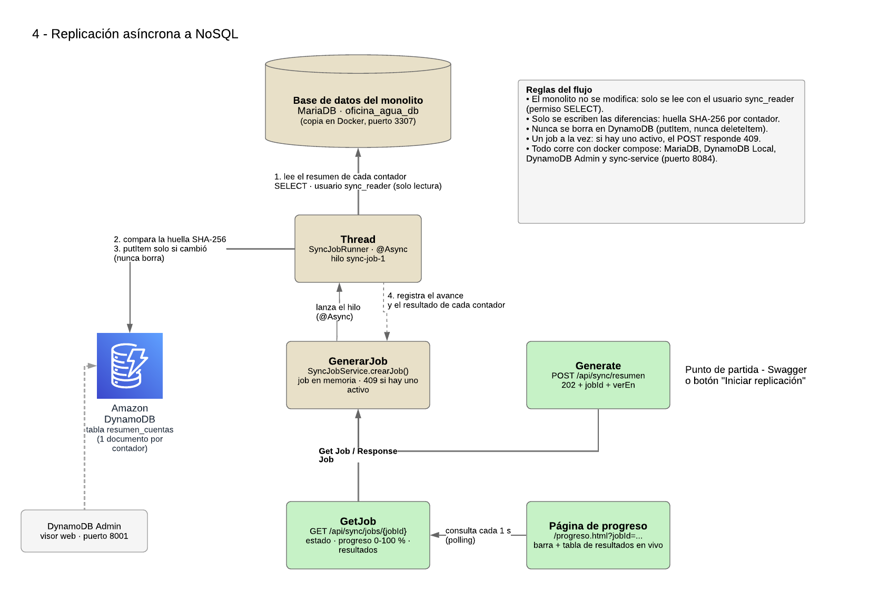

Nombre: Blanky Marisol López Marroquín

Carnet: 0905-23-5227

Repositorio: https://github.com/grupo2-stack1-fase2/fase2-feature4-replicacion-nosql

Modulo asignado: Replicación asíncrona a NoSQL | SQL

---

# Feature 4 — Replicación asíncrona a NoSQL (`sync-service`)

**Oficina del Agua · Fase 2 · Grupo 2 — Stack 1**

Microservicio **Spring Boot 3.5 + Java 17** que replica, de forma **asíncrona**, el
**resumen de cuenta de cada contador** desde la base de datos del monolito AQUORA
(MariaDB/MySQL) hacia una base **NoSQL (DynamoDB)**.

- El cliente pide una replicación y recibe un **`jobId` de inmediato** (`202 Accepted`).
- El trabajo corre **en segundo plano** y su avance (0–100 %) se consulta con el `jobId`.
- Solo se replican **las diferencias** (diff por huella SHA-256 + *upsert*).
- **Nunca se borra** nada en el destino.
- El monolito **no se toca**: se lee con un usuario de **solo lectura**.

---

## Tabla de contenido

**Parte 1 — La solución integrada**
1. [Arquitectura de la solución integrada (Fase 2)](#arquitectura-de-la-solución-integrada-fase-2)

**Parte 2 — Mi módulo**

2. [Mi módulo: Replicación asíncrona a NoSQL](#mi-módulo-replicación-asíncrona-a-nosql)
   - [4.1 Funcionalidad y objetivo](#41-funcionalidad-y-objetivo)
   - [4.2 Integración y responsabilidades](#42-integración-y-responsabilidades)
   - [4.3 Decisión técnica](#43-decisión-técnica)
   - [4.4 Instrucciones para probar el módulo](#44-instrucciones-para-probar-el-módulo)

**Parte 3 — Detalle técnico del módulo**

3. [Arquitectura del módulo (contenedores)](#arquitectura-del-módulo-contenedores)
4. [Endpoints](#endpoints)
5. [Tecnologías](#tecnologías)
6. [Requisitos](#requisitos)
7. [Cómo levantarlo](#cómo-levantarlo)
8. [Cómo probarlo (demo del diff)](#cómo-probarlo-demo-del-diff)
9. [Cómo funciona por dentro](#cómo-funciona-por-dentro)
10. [Seguridad](#seguridad)
11. [Decisiones de diseño](#decisiones-de-diseño)
12. [Configuración (variables de entorno)](#configuración-variables-de-entorno)
13. [Estructura del proyecto](#estructura-del-proyecto)
14. [Solución de problemas](#solución-de-problemas)

---

# Parte 1 — La solución integrada

## Arquitectura de la solución integrada (Fase 2)

La Fase 2 agrega **cuatro funcionalidades nuevas** al sistema de la Oficina del Agua **sin modificar
el monolito heredado** (AQUORA, CodeIgniter 3 + Bootstrap 5, base MariaDB/MySQL `oficina_agua_db`):

1. Consulta pública con captcha.
2. Chatbot con RAG.
3. Envío de pagos a sistemas externos por colas.
4. **Replicación asíncrona a NoSQL** ← este repositorio.

Cada feature es un componente independiente en su propio repositorio. Este módulo se integra con la
solución **únicamente a través de la base de datos del monolito**, que lee en modo de solo lectura;
no llama a las otras features ni ellas a él.

### Diagrama del módulo



### Componentes y qué representa cada conexión

| Componente | Tecnología | Qué hace |
|---|---|---|
| **Base de datos del monolito** | MariaDB · `oficina_agua_db` | Origen de los datos: `clientes`, `contadores`, `lecturas` y `pagos`. En este repositorio corre como **copia en Docker** con datos de prueba (puerto 3307). |
| **Generate** | `POST /api/sync/resumen` | Punto de partida (Swagger o botón de la página). Crea el job y responde **202** con `jobId` y `verEn`. |
| **GenerarJob** | `SyncJobService` | Registra el job en memoria con su estado y progreso; responde **409** si ya hay uno activo. |
| **Thread** | `SyncJobRunner` (`@Async`, hilo `sync-job-1`) | Hace la replicación en segundo plano. |
| **Amazon DynamoDB** | DynamoDB Local (Docker) · AWS SDK v2 | Destino NoSQL: tabla `resumen_cuentas`, un documento por contador. |
| **GetJob** | `GET /api/sync/jobs/{jobId}` | Devuelve estado, progreso (0–100 %) y resultados del job. |
| **Página de progreso** | `progreso.html` (HTML + JS) | Consulta GetJob cada segundo y muestra la barra y la tabla de resultados en vivo. |
| **DynamoDB Admin** | Visor web (puerto 8001) | Permite ver los documentos guardados en DynamoDB. |

| Conexión | Significado |
|---|---|
| Generate → GenerarJob | El `POST` crea el job y lanza el hilo; no espera a que termine. |
| GenerarJob → Thread | Se entrega el trabajo al hilo `sync-job-1` (`@Async`). |
| Thread → Base de datos | **1.** Lee el resumen de cada contador con `SELECT`, usuario `sync_reader` (solo lectura). |
| Thread → DynamoDB | **2.** Compara la huella SHA-256 con la guardada. **3.** `putItem` solo si cambió; nunca borra. |
| Thread → GenerarJob | **4.** Registra el avance y el resultado de cada contador. |
| GetJob → GenerarJob | *Get Job / Response Job*: lee el estado actual del job. |
| Página de progreso → GetJob | *Polling* cada segundo hasta que el job termina. |

### Cómo se ejecuta

Todo el módulo se levanta con **Docker Compose** desde la raíz del repositorio:

```bash
docker compose up -d --build
```

Levanta 4 contenedores: la copia de la base del monolito (`sync-monolito-db`), DynamoDB Local
(`sync-dynamodb`), DynamoDB Admin (`sync-dynamodb-admin`) y el servicio (`sync-service`, puerto 8084).
Los pasos de prueba están en [4.4](#44-instrucciones-para-probar-el-módulo).

---

# Parte 2 — Mi módulo

## Mi módulo: Replicación asíncrona a NoSQL

Además de este módulo, apoyé la **Feature 3 (Envío de pagos a sistemas externos por colas)** con el
script SQL de la tabla `envios_banco` y la colección de Postman del servicio.

### 4.1 Funcionalidad y objetivo

**Qué construí:** un microservicio que copia, **en segundo plano**, el **resumen de cuenta de cada
contador** (cliente, lecturas, total facturado, total pagado, saldo y última lectura) desde la base
de datos del monolito hacia **DynamoDB**.

**Qué problema resuelve:** la Oficina del Agua puede consultar los saldos de sus contadores en una base
NoSQL rápida, **sin cargar la base de datos del sistema principal** y sin modificar el monolito.

**Cómo funciona:**

1. `POST /api/sync/resumen` crea un *job* y responde de inmediato **202 Accepted** con su `jobId` y
   la URL para verlo (`verEn`).
2. El job corre en otro hilo (`@Async`): lee el resumen de cada contador y lo compara con lo guardado
   en DynamoDB. Solo inserta o actualiza lo que cambió; nunca borra.
3. `GET /api/sync/jobs/{jobId}` devuelve el estado, el progreso (0–100 %) y el resultado de cada
   contador. La página `/progreso.html?jobId=...` muestra esa misma información **en vivo**.

### 4.2 Integración y responsabilidades

| Se comunica con | Cómo | Por qué esa frontera |
|---|---|---|
| **Base de datos del monolito** | Solo lectura (`SELECT`) con el usuario `sync_reader` y conexiones en modo *read-only* | **Regla de oro: el monolito no se modifica.** Aunque el código tuviera un error, la base rechaza cualquier escritura (`ERROR 1142`). |
| **DynamoDB** | `putItem` de un documento por contador | Es el destino NoSQL. Nunca se usa `deleteItem`: lo replicado se conserva. |
| **Cliente / navegador** | API REST (contrato OpenAPI) y la página `progreso.html` | El cliente no espera a que termine la copia: recibe un `jobId` y consulta el avance. |
| **Otras features** | Ninguna comunicación directa | Su única fuente es la base del monolito; si este servicio falla, no afecta al monolito ni a los demás módulos. |

### 4.3 Decisión técnica

**Detectar los cambios con una huella SHA-256 en lugar de comparar fechas.**

- **El problema:** para replicar solo las diferencias hay que saber qué cambió. Lo usual es comparar una
  columna de "fecha de modificación", pero las tablas `lecturas` y `pagos` del monolito **no la tienen**,
  y agregarla obligaría a modificar el monolito, lo cual está prohibido.
- **La solución:** por cada contador se calcula una **huella SHA-256** de sus datos de negocio y se guarda
  junto al documento en DynamoDB. En cada replicación se compara la huella nueva con la guardada:
  - no existe → se **inserta**;
  - es distinta → se **actualiza**;
  - es igual → **no se escribe nada**.
- **Por qué es mejor que las alternativas:** copiar todo en cada corrida reescribiría siempre todos los
  registros, y usar fechas requeriría cambiar el monolito. La huella detecta cualquier cambio sin tocar
  el monolito y evita escrituras innecesarias en DynamoDB.

Otras decisiones (respuesta 202 asíncrona, 409 si ya hay un job en curso, un documento por contador,
*polling* de la página): ver [Decisiones de diseño](#decisiones-de-diseño).

### 4.4 Instrucciones para probar el módulo

**Requisitos previos:** Docker Desktop encendido. En Windows, usar Git Bash. No se necesitan
credenciales externas: todo corre en contenedores locales con datos de prueba.

**1. Iniciar los servicios** (desde la carpeta del repositorio):

```bash
docker compose up -d --build
docker ps
```

Deben aparecer 4 contenedores: `sync-monolito-db` (copia de la base del monolito con datos de prueba),
`sync-dynamodb`, `sync-dynamodb-admin` y `sync-service`.

**2. Flujo de prueba:**

| Paso | Acción | Resultado esperado |
|---|---|---|
| 1 | Abrir **http://localhost:8084/progreso.html** y presionar **Iniciar replicación** | Barra de 0 a 100 % y tabla llenándose fila por fila: **8 contadores · 8 insertados** |
| 2 | Presionar **Nueva replicación** sin cambiar nada | **8 sin cambios** (no se escribió nada en DynamoDB) |
| 3 | Simular actividad en el monolito (comando abajo): un pago nuevo y un contador nuevo | — |
| 4 | Presionar **Nueva replicación** | **9 contadores · 1 insertado (`CNT-0009`) · 1 actualizado (`CNT-0001`, saldo Q 37.50 → Q 0.00) · 7 sin cambios** |
| 5 | Abrir **http://localhost:8001** → tabla `resumen_cuentas` | Un documento por contador, incluido `CNT-0009` |

Comando del paso 3 (no muestra nada si sale bien):

```bash
docker exec -i sync-monolito-db sh -c 'mariadb -uroot -p"$MARIADB_ROOT_PASSWORD" oficina_agua_db' < db/demo/cambios-en-el-monolito.sql
```

**3. Otras URL útiles:**

- Swagger UI (probar la API): http://localhost:8084/swagger-ui.html
- Estado del servicio: http://localhost:8084/actuator/health

Para volver a empezar desde cero: `docker compose down -v && docker compose up -d --build`.

---

# Parte 3 — Detalle técnico del módulo

## Arquitectura del módulo (contenedores)

```
                      ┌──────────────────────── docker compose ────────────────────────┐
                      │                                                                │
 Cliente / Swagger    │   ┌──────────────┐  SELECT (solo lectura)  ┌─────────────────┐ │
 POST /api/sync/... ──┼──►│ sync-service │────────────────────────►│  monolito-db    │ │
 GET  /api/sync/jobs  │   │   :8084      │                         │  MariaDB 11.4   │ │
                      │   │              │                         │  (copia AQUORA) │ │
                      │   │  hilo HTTP   │                         └─────────────────┘ │
                      │   │      +       │   putItem solo si cambió ┌─────────────────┐ │
                      │   │ hilo sync-job│────────────────────────►│ dynamodb-local  │ │
                      │   └──────────────┘                         │     :8000       │ │
                      │                                            └────────▲────────┘ │
                      │                                            ┌────────┴────────┐ │
                      │                                            │ dynamodb-admin  │ │
                      │                                            │ :8001 (visor)   │ │
                      │                                            └─────────────────┘ │
                      └────────────────────────────────────────────────────────────────┘
```

| Contenedor | Imagen | Puerto en tu PC | Rol |
|---|---|---|---|
| `sync-monolito-db` | `mariadb:11.4` | **3307** | Copia local de la BD de AQUORA (origen). Usa 3307 para no chocar con Laragon (3306). |
| `sync-dynamodb` | `amazon/dynamodb-local` | 8000 | Destino NoSQL, 100 % local. |
| `sync-dynamodb-admin` | `aaronshaf/dynamodb-admin` | 8001 | Página web para ver las tablas de DynamoDB. |
| `sync-service` | construida con el `Dockerfile` | 8084 | El microservicio. |

---

## Endpoints

Contrato **OpenAPI 3.0.3** (contract-first): [`src/main/resources/static/openapi/sync-api.yaml`](src/main/resources/static/openapi/sync-api.yaml).
Las interfaces y DTOs de Java se **generan** desde ese archivo con `openapi-generator-maven-plugin`.

| Método | Ruta | Respuestas | Descripción |
|---|---|---|---|
| `POST` | `/api/sync/resumen` | **202** · 409 · 500 | Inicia una replicación. Responde de inmediato con `jobId` y el header `Location`. **409** si ya hay una replicación `PENDIENTE` o `EN_PROGRESO`. |
| `GET` | `/api/sync/jobs/{jobId}` | **200** · 400 · 404 · 500 | Estado, progreso y **resultados** del job. **400** si el `jobId` no es un UUID; **404** si no existe. |
| `GET` | `/progreso.html?jobId={jobId}` | página web | **Visualización en vivo**: barra de progreso y tabla con el resultado de cada contador mientras se procesa. Su URL completa viene en el campo `verEn`. |

**Estados del job:** `PENDIENTE` → `EN_PROGRESO` → `COMPLETADO` | `FALLIDO`

**Ejemplo de respuesta del `POST` (202):**

```json
{
  "jobId": "9ff90a03-5b4c-439b-8638-39380a9c042e",
  "estado": "PENDIENTE",
  "consultarEn": "/api/sync/jobs/9ff90a03-5b4c-439b-8638-39380a9c042e",
  "verEn": "http://localhost:8084/progreso.html?jobId=9ff90a03-5b4c-439b-8638-39380a9c042e"
}
```

**Ejemplo de respuesta del `GET`** (`resultados` recortado a 2 de 9 filas):

```json
{
  "jobId": "9ff90a03-5b4c-439b-8638-39380a9c042e",
  "estado": "COMPLETADO",
  "progreso": 100,
  "totalRegistros": 9,
  "procesados": 9,
  "insertados": 1,
  "actualizados": 1,
  "sinCambios": 7,
  "mensaje": null,
  "creadoEn": "2026-10-15T20:03:10.10-06:00",
  "iniciadoEn": "2026-10-15T20:03:10.12-06:00",
  "finalizadoEn": "2026-10-15T20:03:16.90-06:00",
  "verEn": "http://localhost:8084/progreso.html?jobId=9ff90a03-5b4c-439b-8638-39380a9c042e",
  "resultados": [
    { "orden": 1, "contadorId": 1, "numeroRegistro": "CNT-0001", "clienteNombre": "…", "sector": "…",
      "totalFacturado": 125.00, "totalPagado": 125.00, "saldo": 0.00, "accion": "ACTUALIZADO" },
    { "orden": 2, "contadorId": 2, "numeroRegistro": "CNT-0002", "clienteNombre": "…", "sector": "…",
      "totalFacturado": 90.00, "totalPagado": 50.00, "saldo": 40.00, "accion": "SIN_CAMBIOS" }
  ]
}
```

`accion` indica qué hizo el diff con cada contador: `INSERTADO` (no existía en DynamoDB),
`ACTUALIZADO` (existía pero cambió) o `SIN_CAMBIOS` (igual al destino; no se escribió).

Errores con el mismo formato en todos los casos (schema `Error`):

```json
{ "status": 409, "message": "Ya hay una replicacion en curso; espere a que termine", "details": [] }
```

- **Página de progreso (iniciar y ver en vivo):** http://localhost:8084/progreso.html
- **Swagger UI:** http://localhost:8084/swagger-ui.html
- **Salud:** http://localhost:8084/actuator/health

---

## Tecnologías

| Capa | Tecnología |
|---|---|
| Lenguaje / framework | Java 17 · Spring Boot 3.5.6 |
| API | OpenAPI 3.0.3 (contract-first) · openapi-generator 7.12.0 · springdoc (Swagger UI) |
| Asincronía | `@Async` + `ThreadPoolTaskExecutor` (hilo `sync-job-1`) |
| Origen | MariaDB 11.4 · Spring JDBC (`JdbcTemplate`) · driver MariaDB |
| Destino | DynamoDB Local · AWS SDK for Java v2 |
| Contenedores | Docker · Docker Compose · Dockerfile multi-stage |

---

## Requisitos

- **Docker Desktop** (con "Engine running").
- Solo si vas a correrlo fuera de Docker: **JDK 17** y **Maven 3.9+**.
- En Windows, usar **Git Bash** para los comandos de este README.

---

## Cómo levantarlo

### Opción A — Todo con Docker (recomendada)

```bash
docker compose up -d --build
docker ps
```

Deben aparecer **4 contenedores** (`sync-monolito-db` en estado *healthy*).
La primera vez tarda varios minutos: descarga las imágenes y compila el proyecto dentro de Docker.

- Swagger: http://localhost:8084/swagger-ui.html
- DynamoDB Admin: http://localhost:8001

### Opción B — Infraestructura en Docker y la app en tu PC (para desarrollar)

```bash
docker compose up -d monolito-db dynamodb-local dynamodb-admin
mvn clean package
java -jar target/sync-service-0.0.1-SNAPSHOT.jar
```

> No uses las dos opciones a la vez: ambas usan el puerto **8084**.
> Para apagar el contenedor de la app y quedarte con la opción B: `docker compose stop sync-service`.

### Apagar y reiniciar

```bash
docker compose stop            # apaga, conserva los datos
docker compose start           # vuelve a encender
docker compose down -v         # BORRA todo (BD y DynamoDB) para empezar de cero
```

---

## Cómo probarlo (demo del diff)

### Opción visual: la página de progreso

1. Abre **http://localhost:8084/progreso.html** y presiona **Iniciar replicación**
   (o ejecuta el `POST` en Swagger y abre la URL del campo `verEn`).
2. La página consulta `GET /api/sync/jobs/{jobId}` **cada segundo** y muestra:
   - la **barra de progreso** (0–100 %) y el estado del job,
   - los totales: insertados, actualizados y sin cambios,
   - la **tabla de resultados**, que se llena fila por fila mientras el job avanza.
3. Cuando el job termina deja de consultar y se habilita **Nueva replicación**.

### Comando de prueba (una sola línea, Git Bash)

Lanza una replicación, muestra el progreso y al final imprime el resultado:

```bash
JOB=$(curl -s -X POST http://localhost:8084/api/sync/resumen | grep -oE '[0-9a-f-]{36}' | head -1); echo "Job: $JOB"; for i in 1 2 3 4; do curl -s http://localhost:8084/api/sync/jobs/$JOB | grep -oE '"estado":"[A-Z_]+","progreso":[0-9]+'; sleep 2; done; curl -s http://localhost:8084/api/sync/jobs/$JOB | grep -oE '"(estado|totalRegistros|insertados|actualizados|sinCambios)":"?[A-Z_0-9]+"?' | tr '\n' ' '; echo
```

### Escenario completo (desde la carpeta del proyecto, con la BD recién creada)

| Paso | Acción | Resultado esperado |
|---|---|---|
| 1 | Ejecutar el comando de prueba (DynamoDB vacío) | `totalRegistros 8 · insertados 8 · actualizados 0 · sinCambios 0` |
| 2 | Ejecutarlo otra vez, sin cambiar nada | `totalRegistros 8 · insertados 0 · actualizados 0 · sinCambios 8` |
| 3 | Simular actividad en AQUORA (ver abajo) | — |
| 4 | Ejecutar el comando de prueba | `totalRegistros 9 · insertados 1 · actualizados 1 · sinCambios 7` |
| 5 | Ejecutarlo otra vez | `totalRegistros 9 · insertados 0 · actualizados 0 · sinCambios 9` |

**Paso 3 — simular actividad en el monolito** (se ejecuta como `root`, "como si fuera AQUORA"; no imprime nada si sale bien):

```bash
docker exec -i sync-monolito-db sh -c 'mariadb -uroot -p"$MARIADB_ROOT_PASSWORD" oficina_agua_db' < db/demo/cambios-en-el-monolito.sql
```

El script hace dos cosas:
- **Maria Lopez paga septiembre** del contador `CNT-0001` → su resumen **cambia** (saldo 37.50 → 0).
- **Se registra un contador nuevo** `CNT-0009` → resumen **nuevo**.

En **DynamoDB Admin** (http://localhost:8001 → tabla `resumen_cuentas`) se puede comprobar:
- `CNT-0001` con `saldo: 0` y `lecturasPendientes: 0`.
- `CNT-0009` insertado.
- El `jobId` de `CNT-0001` es el del **paso 4**, no el del paso 5: en el paso 5 la huella era igual y **no se reescribió**.

> Si usas DynamoDB Admin en Chrome, desactiva el traductor automático: traduce los nombres de los atributos.

### Probar los errores

```bash
curl -i http://localhost:8084/api/sync/jobs/abc                                   # 400 (no es UUID)
curl -i http://localhost:8084/api/sync/jobs/00000000-0000-0000-0000-000000000000  # 404 (no existe)
```

Para el **409**: hacer dos `POST /api/sync/resumen` seguidos (el segundo mientras el primero corre).

### Datos de prueba incluidos

`db/init/02-data.sql`: 5 clientes, 8 contadores, lecturas de 2026-08 y 2026-09 (tarifa Q2.50/m³) y 7 pagos.

| Contador | Cliente | Total facturado | Total pagado | Saldo |
|---|---|---:|---:|---:|
| CNT-0001 | Maria Lopez | 82.50 | 45.00 | 37.50 |
| CNT-0002 | Maria Lopez | 55.00 | 25.00 | 30.00 |
| CNT-0003 | Jose Perez | 117.50 | 117.50 | 0.00 |
| CNT-0004 | Ana Garcia | 52.50 | 0.00 | 52.50 |
| CNT-0005 | Ana Garcia | 22.50 | 10.00 | 12.50 |
| CNT-0006 | Carlos Ramirez | 140.00 | 75.00 | 65.00 |
| CNT-0007 | Lucia Morales | 42.50 | 20.00 | 22.50 |
| CNT-0008 | Lucia Morales | 0.00 | 0.00 | 0.00 |

---

## Cómo funciona por dentro

### 1. El `POST` responde de inmediato (asíncrono)

```
POST /api/sync/resumen
  │
  ├─ SyncJobService.crearJob()        → registra el job (PENDIENTE); 409 si ya hay uno activo
  ├─ SyncJobRunner.ejecutar(jobId)    → @Async: se entrega al hilo "sync-job-1" y regresa YA
  └─ 202 Accepted + Location + verEn  → el cliente recibe el jobId y la URL de la página
```

Relación con el diagrama de la feature:

| Caja del diagrama | En el código |
|---|---|
| **Generate** (punto de partida, Swagger) | `POST /api/sync/resumen` → `SyncController.iniciarReplicacionResumen()` |
| **GenerarJob** | `SyncJobService.crearJob()` |
| **Thread** → **Amazon DynamoDB** | `SyncJobRunner.ejecutar()` (`@Async`, hilo `sync-job-1`) → `ResumenDestinoRepository.guardar()` |
| **GetJob** / *Response Job* | `GET /api/sync/jobs/{jobId}` (JSON) y su visualización `progreso.html` |

`SyncJobRunner` es una clase aparte porque `@Async` solo funciona cuando el método se llama
desde **otro** bean.

### 2. El job replica solo las diferencias

Para cada contador:

1. **Leer** su resumen del monolito (`ResumenOrigenRepository`, una consulta SQL que agrupa
   `contadores`, `clientes`, `lecturas` y `pagos`).
2. **Calcular su huella** SHA-256 (`HuellaResumen`) con los datos de negocio.
3. **Comparar** con la huella guardada en DynamoDB (`ResumenDestinoRepository`):

| Caso | Acción en DynamoDB | Contador |
|---|---|---|
| No existe en DynamoDB | `putItem` (crea) | `insertados++` |
| Existe y la huella es distinta | `putItem` (reemplaza) | `actualizados++` |
| Existe y la huella es igual | **no se escribe nada** | `sinCambios++` |

4. Actualizar el **progreso** (`procesados * 100 / total`).

Nunca se llama a `deleteItem`: lo que ya está en el destino no se elimina.

### 3. Documento que se guarda en DynamoDB

Tabla `resumen_cuentas`, clave primaria `contadorId` (número). Un item por contador:

```json
{
  "contadorId": 1,
  "numeroRegistro": "CNT-0001",
  "direccionServicio": "4a calle 5-20 zona 1",
  "sector": "Centro",
  "contadorActivo": true,
  "clienteId": 1,
  "clienteNombre": "Maria Lopez",
  "totalLecturas": 2,
  "lecturasPendientes": 0,
  "totalFacturado": 82.5,
  "totalPagado": 82.5,
  "saldo": 0,
  "ultimoPeriodo": "2026-09",
  "ultimaLectura": 133,
  "huella": "bdb076c993227f04518631b856ed9894b9a149451ddc284b70b94b228f77e850",
  "sincronizadoEn": "2026-10-15T20:03:16.28-06:00",
  "jobId": "9ff90a03-5b4c-439b-8638-39380a9c042e"
}
```

---

## Seguridad

- **Regla de oro: el monolito no se toca.** El servicio corre al lado de AQUORA, nunca dentro.
- **Usuario de solo lectura** `sync_reader` (`db/init/03-usuario-solo-lectura.sql`): solo tiene
  permiso `SELECT`. Aunque el código tuviera un error, la BD rechazaría cualquier escritura:

  ```bash
  docker exec -it sync-monolito-db mariadb -usync_reader -p oficina_agua_db -e "DELETE FROM pagos;"
  # (pide la contraseña del usuario sync_reader)
  # ERROR 1142 (42000): DELETE command denied to user 'sync_reader'
  ```

- **Conexiones en modo lectura** (`spring.datasource.hikari.read-only: true`): segunda barrera.
- **Sin credenciales en la imagen ni en el código:** todo llega por variables de entorno.
- **Errores sin detalles internos:** `include-stacktrace: never`; el detalle de un 500 solo va al log.
- **Ninguna credencial real en el repositorio:** las únicas contraseñas son las de los contenedores de prueba locales
  (base de datos con datos ficticios) y no corresponden a ningún sistema real. No se publican claves de AWS, tokens ni archivos `.env`.

---

## Decisiones de diseño

| Decisión | Por qué |
|---|---|
| **Diff por huella SHA-256** en vez de fechas | Las tablas `lecturas` y `pagos` del monolito no tienen `actualizado_en`, así que no se puede saber por fecha qué cambió. La huella detecta cualquier cambio en los datos del resumen. |
| **Upsert con `putItem`, nunca `deleteItem`** | Requisito de la feature: el destino conserva todo lo replicado. |
| **Un documento por contador** | Es la unidad del estado de cuenta: cada contador tiene sus propias lecturas, facturación y saldo, y un cliente puede tener varios contadores. |
| **`JdbcTemplate` en vez de entidades JPA** | Solo se necesita **leer** el resultado de una consulta agregada de 4 tablas; no se crean, editan ni borran registros. |
| **Jobs en memoria** (`ConcurrentHashMap`) | Suficiente para la fase local. Si el servicio se reinicia, el historial de jobs se pierde, pero los datos ya replicados quedan en DynamoDB. |
| **Página con *polling* cada segundo** (en vez de WebSockets/SSE) | Es lo más simple de entender y depurar: la página usa el mismo `GET` que cualquier cliente. Con un job de segundos o minutos, 1 consulta por segundo no carga al servicio. |
| **Resultados guardados en el job** (`CopyOnWriteArrayList`) | El hilo del job agrega filas mientras el `GET` las convierte a JSON; esta lista permite leer y escribir a la vez sin errores. |
| **Un solo hilo** + **409** | Evita dos replicaciones escribiendo al mismo tiempo en DynamoDB. |
| **`jobId` como UUID** | No se puede adivinar ni se repite. |
| **Puerto 8084** | Para no chocar con los otros microservicios del equipo. |
| **Mismo código para DynamoDB Local y AWS** | Solo cambia `DYNAMODB_ENDPOINT`: si está vacío, el SDK usa DynamoDB real con las credenciales de AWS (en ECS, las del *Task Role*). |
| **Pausa de demo** (`SYNC_PAUSA_MS`) | Con pocos datos el job terminaría en milisegundos y no se vería el progreso. En producción sería `0`. |

---

## Configuración (variables de entorno)

| Variable | Valor por defecto (local) | Descripción |
|---|---|---|
| `SERVER_PORT` | `8084` | Puerto HTTP |
| `DB_URL` | `jdbc:mariadb://localhost:3307/oficina_agua_db` | BD del monolito (origen) |
| `DB_USERNAME` | `sync_reader` | Usuario de **solo lectura** |
| `DB_PASSWORD` | valor de prueba local | Contraseña del usuario de solo lectura |
| `DYNAMODB_ENDPOINT` | `http://localhost:8000` | DynamoDB Local. **Vacío = DynamoDB real de AWS** |
| `AWS_REGION` | `us-east-2` | Región |
| `DYNAMODB_TABLE` | `resumen_cuentas` | Tabla destino (se crea sola si no existe) |
| `SYNC_PAUSA_MS` | `700` | Pausa por registro, solo para la demo |

Dentro de `docker compose` los valores cambian (por ejemplo `monolito-db:3306` en vez de
`localhost:3307`), porque los contenedores se comunican por el **nombre del servicio**.

---

## Estructura del proyecto

```
fase2-feature4-replicacion-nosql/
├── Dockerfile                         # imagen multi-stage (compila y ejecuta)
├── docker-compose.yml                 # monolito-db + dynamodb-local + dynamodb-admin + sync-service
├── pom.xml
├── docs/
│   ├── feature4-replicacion-nosql.png    # diagrama del módulo
│   └── feature4-replicacion-nosql.drawio # mismo diagrama, editable en draw.io
├── db/
│   ├── init/
│   │   ├── 01-schema.sql              # copia del esquema de AQUORA (migraciones de la fase 1)
│   │   ├── 02-data.sql                # datos de prueba
│   │   └── 03-usuario-solo-lectura.sql
│   └── demo/
│       └── cambios-en-el-monolito.sql # simula actividad para probar el diff
└── src/main/
    ├── resources/
    │   ├── application.yml
    │   └── static/
    │       ├── openapi/sync-api.yaml      # ⭐ EL CONTRATO
    │       └── progreso.html              # página de progreso en vivo (HTML + JS, sin librerías)
    └── java/gt/edu/umg/desarrolloweb/sync/
        ├── SyncServiceApplication.java
        ├── config/       AsyncConfig, DynamoDbConfig
        ├── controller/   SyncController (implementa SyncApi generada), GlobalExceptionHandler
        ├── service/      SyncJobService, SyncJobRunner (@Async), HuellaResumen, excepciones
        ├── repository/   ResumenOrigenRepository (MariaDB), ResumenDestinoRepository (DynamoDB)
        └── model/        ResumenContador
```

El código generado desde el contrato (`SyncApi`, `*Dto`) vive en `target/generated-sources/openapi/`
y **no se versiona**.

---

## Solución de problemas

| Síntoma | Causa probable | Solución |
|---|---|---|
| El job termina en `FALLIDO` | MariaDB o DynamoDB no están encendidos | Revisar `docker ps`; el campo `mensaje` del `GET` indica la causa |
| `Port 8084 already in use` | La app corre en tu PC y en Docker a la vez | Usar solo una opción (ver [Cómo levantarlo](#cómo-levantarlo)) |
| `bind: 3307 already allocated` | Otro contenedor usa el 3307 | `docker ps` y detener el otro contenedor |
| `ClassNotFoundException` al correr con `java -jar` | VS Code compiló encima de `target/` | Cerrar VS Code y `mvn clean package` |
| `No such file or directory` al correr el script de demo | No estás en la carpeta del proyecto | `cd ~/proyectos/fase2-feature4-replicacion-nosql` |
| Quiero empezar de cero | — | `docker compose down -v && docker compose up -d --build` |